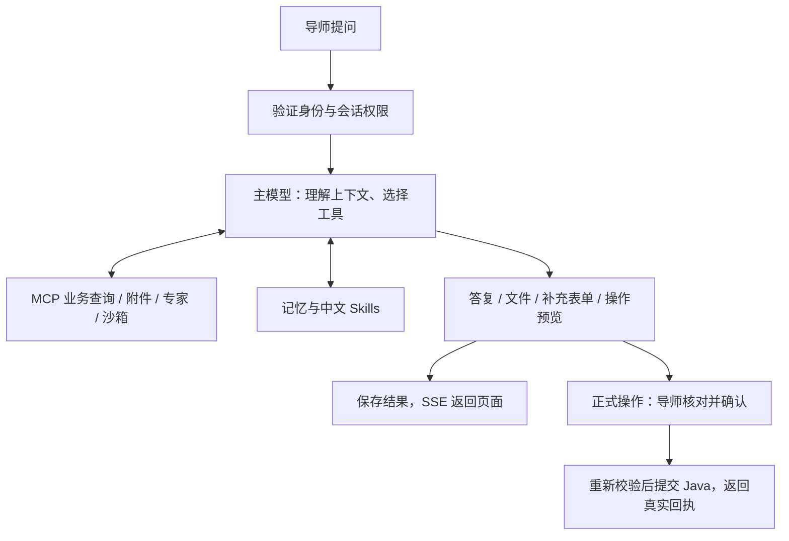

# InsightLink｜学业导师点评系统与 AI 助手

面向高校学业指导，支持管理员、导师、学生三个角色，提供材料提交、能力评价、师生留言和学情查询。独立 AI 助手扩展了自然语言取数、附件阅读、分析报告和评价草稿等功能，正式评价与留言须经导师确认。

## 项目组成

| 目录 | 技术与职责 | 默认端口 |
| --- | --- | --- |
| `insight-link-web` | Vue 3、Vite、Element Plus；业务页面与 AI 聊天界面 | 5173 |
| `insight-link-server/insight-link` | Java 17、Spring Boot、MyBatis、MySQL；鉴权与正式业务数据 | 8080 |
| `insight-link-agent` | FastAPI、DeepAgents、LangGraph、MCP、MongoDB；Agent 编排与沙箱 | 8001 |

前后端按下述步骤本地运行；Docker Compose 仅部署 Agent、MongoDB 和沙箱镜像。

## 前后端配置与运行

需要 JDK 17、Maven、Node.js 20.19+ 或 22.12+，以及已有业务表结构的 MySQL。初始化 SQL 脚本在 insight-link-server/SQL 中。

### 后端

在后端目录首次复制配置，已有配置不要覆盖：

```powershell
cd insight-link-server/insight-link
Copy-Item ./src/main/resources/application-dev.yml.example ./src/main/resources/application-dev.yml
```

编辑 `application-dev.yml`，填写数据库连接、JWT 签名密钥及 OSS 配置。公共配置 `application.yml` 默认启用 `dev`，端口为 `8080`。

完成配置后，在该目录启动：

```powershell
mvn org.springframework.boot:spring-boot-maven-plugin:2.7.3:run
```

也可在 IDE 中运行 `com.psqin.InsightLinkApplication`。接口文档：`http://localhost:8080/doc.html`。

### 前端

从仓库根目录另开终端：

```powershell
cd insight-link-web
npm ci
npm run dev
```

访问 `http://localhost:5173`，使用导师账号登录。当前前端未附带环境配置文件，地址在以下位置修改：

| 文件 | 修改内容 |
| --- | --- |
| [vite.config.js](insight-link-web/vite.config.js) | `server.proxy` 中的 Java 地址，默认 `http://localhost:8080`；仅开发服务器生效 |
| [src/api/agentHttp.js](insight-link-web/src/api/agentHttp.js) | Agent 默认地址 `http://127.0.0.1:8001` |
| [src/views/AppLayout.vue](insight-link-web/src/views/AppLayout.vue) | `initWebSocket()` 中的连接地址，默认页面所在主机的 `8080` 端口 |

## Agent 部署

需要 Docker 的 Linux 容器环境和 Docker Compose 2.24+。在新终端进入 Agent 目录，首次复制配置：

```powershell
cd insight-link-agent
Copy-Item .env.example .env
```

Linux 使用 `cp .env.example .env`。编辑的是 **Agent 目录内的 `.env`**，主要参数如下；全部字段见 [.env.example](insight-link-agent/.env.example)。

| 参数 | 用途 |
| --- | --- |
| `MODEL_NAME`、`MODEL_API_KEY`、`MODEL_BASE_URL` | 支持工具调用的主模型名称、密钥和接口地址 |
| `DOCKER_JAVA_BASE_URL` | 容器访问 Java 的地址；同宿主默认 `http://host.docker.internal:8080`，分机填写实际地址 |
| `CORS_ORIGINS` | 浏览器前端来源，默认允许本机 5173；多个地址用逗号分隔 |
| `ATTACHMENT_ALLOWED_HOSTS` | 允许下载材料附件的域名，多个用逗号分隔；仅支持 HTTPS，留空不下载 |
| `DOCKER_MONGODB_URL` | 默认 `mongodb://mongodb:27017`，使用 Compose 自带 MongoDB |
| `MONGODB_DATABASE`、`MONGODB_COLLECTION` | 库名与集合前缀；沿用原数据时保持不变 |
| `AGENT_BIND_ADDRESS`、`AGENT_PORT` | 默认 `127.0.0.1:8001`；供其他机器访问时监听地址改为 `0.0.0.0` |

填写完成后运行：

```bash
docker compose up -d --build
docker compose ps -a
docker compose logs --tail 100 agent
```

健康检查：`http://127.0.0.1:8001/health`。修改配置后执行 `docker compose up -d`，修改代码后加 `--build`。停止使用 `docker compose down`，保留 MongoDB 数据时不要添加 `-v`。

沙箱镜像验证服务显示 `Exited (0)` 属正常状态；实际沙箱按任务创建并销毁。Compose 使用宿主 Docker 引擎，无需另外创建 SSH Context。

分机运行时，同步修改前端 Agent 地址、CORS 和 Java 地址。浏览器中的 `127.0.0.1` 指浏览器所在电脑，容器中的 `localhost` 指容器自身。更多部署与本机 Python 调试说明见 [Agent README](insight-link-agent/README.md)。

## Agent 工作流程

模型结合当前问题、历史上下文和授权数据自主选择工具，可查询学生与全班材料、阅读 PDF/DOCX、比较学情、制作图表报告、起草评价及准备留言。普通聊天直接进入模型工具循环，不依赖固定关键词分类，也没有统一复核模型拦截每条回答。



## Harness Engineering 设计

参考 ERP-AGENT，为模型配置工具、上下文、运行约束、反馈和恢复机制，使回答能够落到可核对的业务操作中。

| 部分 | 实现 |
| --- | --- |
| 计划与执行 | 复杂任务按需维护 Todo；工具返回真实结果，代码限制模型轮数、分页和调用预算 |
| 业务 MCP | FastMCP 本地 stdio 连接 Java；请求级转发当前导师 token，不将凭据交给模型 |
| 中文 Skills | 保存查询、评价、分析等方法；支持个人技能版本与启停，新问法可组合现有工具处理 |
| 两个专家 | 学情分析专家负责比较、统计与产物；评价与沟通专家负责草稿、补充信息和预览 |
| 三层记忆 | HOT 保存当前会话与图状态；WARM 自动注入偏好和近期摘要；COLD 按需检索长期记忆。导师评分标准独立长期保存 |
| 上下文压缩 | 默认达到配置窗口 85% 时摘要，保留近期消息；长结果归档到 MongoDB，必要时分页回读 |
| Docker 沙箱 | 附件解析与 Python 分析使用任务级容器，限制网络、资源和运行时间；文件保存后鉴权下载 |
| 人工确认 | 缺字段可填表或聊天补充，也可要求 AI 起草；评价增删改和留言发送须核对预览后确认 |
| 取消与恢复 | 服务端管理任务、租约、检查点和工具回执；停止需确认资源退出，恢复需检查当前执行状态 |
| 进度与观测 | SSE 返回进度与结果；LangSmith 默认关闭，启用后仅上报脱敏运行统计 |

评价草稿保留专用校验与有限修订流程。正式成绩和留言以 Java 执行结果为准，模型文本不作为提交成功的证据。公开搜索使用独立的 DeepSeek Responses 网页能力，正文由受限 HTTP 客户端读取。

源码重点：`app/` 负责 API、执行与持久化，`agent/` 负责模型、工具、Skills、专家和中间件，`integrations/` 连接 Java、MCP、附件及网页，`sandbox/` 保存容器内程序。运行凭据只填入本地配置，不随源码提交。
