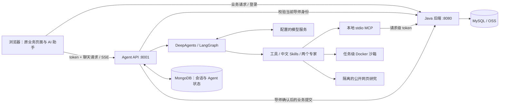
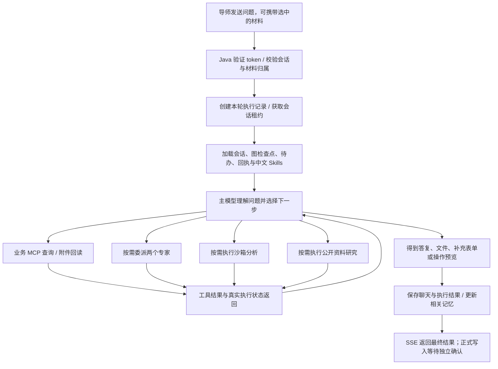
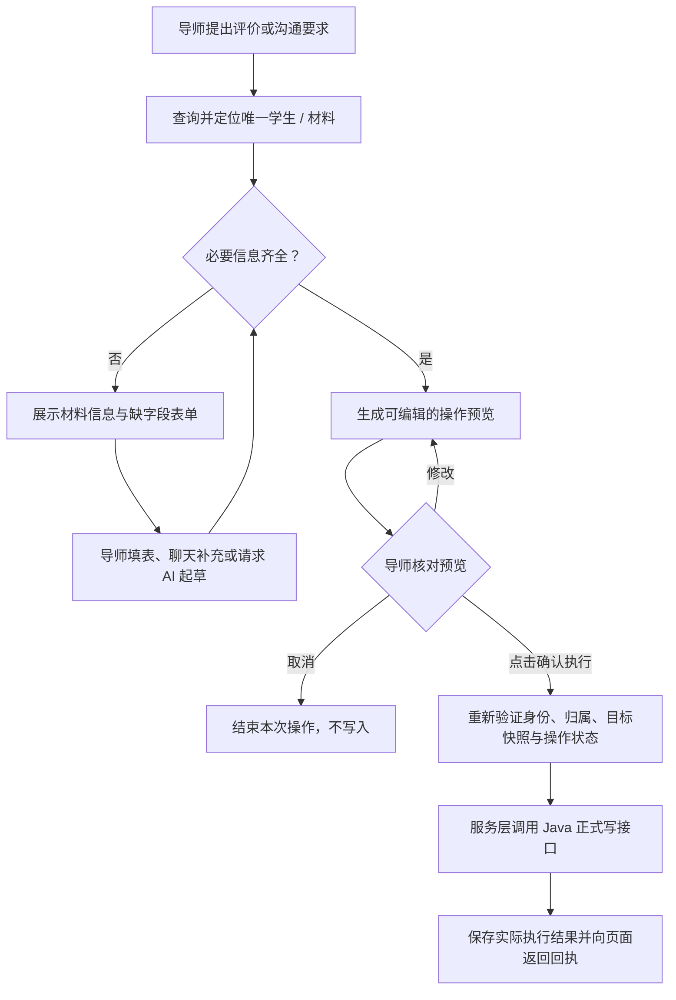

# InsightLink｜学业导师点评系统与 AI 助手

InsightLink 面向高校学业指导场景，包含管理员、导师和学生三个角色。学生提交学习材料，导师查看学情、进行能力评价和留言沟通，管理员维护用户与学校组织信息。

项目的主要扩展是独立的 **学业 AI Agent**：连接已有业务数据，理解导师的自然语言问题，自主选择查询、附件阅读、分析和草稿工具，并通过人工确认流程提交正式评价或留言。实现参考 ERP-AGENT 的组织思路，使用 DeepAgents、LangGraph、MCP、中文 Skills、分层记忆和 Docker 沙箱构建运行环境。

本文先说明前后端配置与本地运行，再重点介绍 Agent 部署、工作流程和 **Harness Engineering（Agent 运行支撑工程）** 的实现。

## 1. 项目组成

```text
InsightLink/
├─ README.md                         # 项目说明、运行步骤与 Agent 架构
├─ .gitignore                        # 整个仓库共用的忽略规则
├─ insight-link-web/                 # Vue 前端，包含导师 AI 对话页面
├─ insight-link-server/
│  └─ insight-link/                  # Spring Boot 业务后端
└─ insight-link-agent/               # 独立 Python Agent、配置示例和沙箱镜像
```

| 模块 | 主要技术 | 职责 | 默认地址 |
| --- | --- | --- | --- |
| 前端 | Vue 3、Vite 7、Element Plus、Pinia、ECharts | 原业务页面、AI 聊天、进度、补充表单、确认预览和产物下载 | `http://localhost:5173` |
| Java 后端 | Java 17、Spring Boot 2.7.3、Spring Security、MyBatis、MySQL、JWT、阿里云 OSS | 登录鉴权、学生与材料、正式评价、留言、组织信息和文件上传 | `http://localhost:8080` |
| Agent | Python 3.13+、FastAPI、DeepAgents、LangGraph、FastMCP、MongoDB | 模型工具循环、专家协作、记忆、确认流程、任务恢复和沙箱分析 | `http://127.0.0.1:8001` |

**业务数据的最终记录在 Java 后端及其数据库中。** Agent 的 MongoDB 保存对话、记忆、待确认操作、执行状态和生成文件。模型生成的草稿不会自动变为正式成绩。



## 2. 准备环境与启动顺序

前后端提供本地配置和运行步骤；**当前 Docker Compose 只部署 Agent 相关服务，不包含 Vue 前端、Java 后端或 MySQL。**

| 环境 | 要求 |
| --- | --- |
| Java / Maven | JDK 17、可用的 Maven；`java -version` 与 `mvn -version` 都应指向 JDK 17 |
| Node.js / npm | Node.js `20.19+` 或 `22.12+`，以及 npm；对应当前 Vite 的运行要求 |
| MySQL | 准备已有业务表结构和数据的配套数据库；本目录没有初始化 SQL，也不会自动建表 |
| Docker | Docker Engine，或 Docker Desktop 的 Linux 容器模式；Agent Compose 使用 Docker Compose 2.24+ |
| 模型 | 支持工具调用的 OpenAI 兼容聊天接口及可用密钥 |
| MongoDB | Agent Compose 默认提供；直接运行 Python 时自行准备可访问的 MongoDB |

本地联调的顺序：

1. 配置并启动 Java 后端，确认数据库连接正常。
2. 配置并部署 Agent，确认 `/health` 可访问。
3. 启动前端，使用导师账号登录后打开“学业 AI 助手”。

各服务需要分别运行。以下相对目录均以本仓库为起点；切换到子目录后，后续命令在该子目录执行。

## 3. Java 后端：配置与本地运行

### 3.1 创建本地配置

进入 `insight-link-server/insight-link`，复制示例。下列复制命令适用于 PowerShell；已有本地配置时直接编辑，不要覆盖。

```powershell
cd insight-link-server/insight-link
Copy-Item ./src/main/resources/application-dev.yml.example ./src/main/resources/application-dev.yml
```

配置文件：

- [application.yml](insight-link-server/insight-link/src/main/resources/application.yml)：端口、激活环境、连接参数引用和通用设置，当前默认启用 `dev`。
- [application-dev.yml.example](insight-link-server/insight-link/src/main/resources/application-dev.yml.example)：无真实凭据的字段示例。
- `application-dev.yml`：复制后自行填写的真实本地配置，已由根目录 `.gitignore` 忽略。

| 配置位置 | 需要填写或修改的内容 |
| --- | --- |
| `sky.datasource` | MySQL 的 `host`、`port`、`database`、`username`、`password` |
| `sky.jwt.admin-secret-key` | 自行生成的随机签名密钥；不要使用空值。修改后旧登录令牌将失效 |
| `sky.alioss` | `endpoint`、`access-key-id`、`access-key-secret`、`bucket-name`；使用材料文件上传时配置 |
| 公共配置的 `server.port` | 默认 `8080`；如修改，需要同步调整前端代理、WebSocket 和 Agent 的业务地址 |

公共配置中的 JWT 密钥读取 `${JWT_SECRET}`。本地配置示例提供的 `sky.jwt.admin-secret-key` 可以直接填写并覆盖它；也可以在本地配置中使用 `${JWT_SECRET}`，由环境变量提供实际值。

### 3.2 启动

可以在 IDE 中导入 `pom.xml`，使用 JDK 17 运行：

```text
com.psqin.InsightLinkApplication
```

也可以在后端模块目录使用 Maven。当前 POM 未显式声明启动插件，命令中指定 Spring Boot 插件的完整坐标，不需要修改 POM：

```powershell
mvn org.springframework.boot:spring-boot-maven-plugin:2.7.3:run
```

默认接口文档地址：`http://localhost:8080/doc.html`。后端根路径没有页面并不代表启动失败，应结合启动日志、接口文档和实际登录接口检查。

## 4. 前端：配置与本地运行

### 4.1 需要修改的地址

前端当前没有附带 `.env.development` 或 `.env.example`，直接按现有代码中的位置配置：

| 文件 | 配置内容 |
| --- | --- |
| [vite.config.js](insight-link-web/vite.config.js) | `server.port` 默认 `5173`；`server.proxy` 将 `/admin`、`/teacher`、`/student`、`/user`、`/school-hierarchy`、`/message` 转发到业务后端，默认 `http://localhost:8080` |
| [src/api/agentHttp.js](insight-link-web/src/api/agentHttp.js) | Agent 的 `baseURL`，未设置环境变量时使用 `http://127.0.0.1:8001`；换机器时修改这个默认地址 |
| [src/views/AppLayout.vue](insight-link-web/src/views/AppLayout.vue) | `initWebSocket()` 中的 WebSocket 地址，当前使用页面所在主机和 `8080` 端口；Java 与前端不在同一主机时需同步调整 |

业务请求在 [src/api/http.js](insight-link-web/src/api/http.js) 中默认使用空的基础地址。例如请求 `/user/info`，浏览器先请求前端开发服务器，再由 Vite 代理到 Java 后端。`server.proxy` 只在开发服务器中生效，前端构建后的静态文件需要由其运行环境提供正确的接口地址或代理。

**地址按实际发起请求的一方理解：**浏览器中的 `127.0.0.1` 是浏览器所在电脑；Agent 容器中的 `localhost` 是 Agent 容器本身。前端、Java 和 Agent 分机运行时不能全部保留回环地址。

### 4.2 安装与启动

在单独终端中，从仓库根目录进入前端：

```powershell
cd insight-link-web
npm ci
npm run dev
```

访问 `http://localhost:5173`，使用已有导师账号登录。AI 助手页面为 `/#/teacher/assistant`，能力评价页面也可以携带材料上下文跳转到助手。

需要检查前端构建时运行 `npm run build`。该命令生成静态资源，不会部署或启动 Java 和 Agent。

## 5. Agent：Docker 部署

### 5.1 配置入口

Agent 的配置保存在 **`insight-link-agent/.env`，不是仓库根目录**。全部可编辑字段及中文说明见 [.env.example](insight-link-agent/.env.example)，更详细的运行说明见 [Agent README](insight-link-agent/README.md)。

在新的终端中进入 Agent 目录。首次配置时执行以下一种复制命令：

```powershell
cd insight-link-agent
Copy-Item .env.example .env
```

Linux 中对应使用 `cp .env.example .env`。已有 `.env` 时只修改需要的字段。

### 5.2 首次部署重点填写的参数

| 参数 | 配置方式 |
| --- | --- |
| `MODEL_NAME`、`MODEL_API_KEY`、`MODEL_BASE_URL` | 主模型名称、密钥和接口基础地址；使用支持工具调用的聊天模型。接口基础地址按提供商实际要求填写 |
| `REVIEW_MODEL_NAME` | 摘要、配置变更授权和评价复核使用的辅助模型；留空沿用主模型 |
| `DOCKER_JAVA_BASE_URL` | Agent 容器访问 Java 的地址。Java 在 Docker 宿主机上时默认 `http://host.docker.internal:8080`；在其他机器上时填写其可访问地址 |
| `CORS_ORIGINS` | 浏览器前端的来源，例如 `http://localhost:5173`；多个地址用逗号分隔，包含协议和端口 |
| `ATTACHMENT_ALLOWED_HOSTS` | 业务材料附件所在的可信域名，多个用逗号分隔，不填写协议或路径。附件下载仅接受 HTTPS；留空时不下载附件 |
| `MONGODB_DATABASE`、`MONGODB_COLLECTION` | 数据库名称和集合名前缀；沿用已有对话与记忆时保留原值 |
| `DOCKER_MONGODB_URL` | 默认 `mongodb://mongodb:27017`，连接 Compose 自带 MongoDB；使用外部 MongoDB 时改为容器可访问的 URI |
| `AGENT_BIND_ADDRESS`、`AGENT_PORT` | 默认只发布到宿主的 `127.0.0.1:8001`。供其他机器直接访问时将监听地址改为 `0.0.0.0`，并同步修改前端 Agent 地址与 CORS |

可选配置：

- **公开搜索**：填写 `WEB_SEARCH_API_KEY`，或显式配置 `DEEPSEEK_API_KEY`。当前搜索调用 DeepSeek Responses 的内置 `web_search`；`WEB_SEARCH_MODEL` 和 `DEEPSEEK_RESPONSES_URL` 需与可用服务对应。搜索不会自动复用任意主模型密钥。
- **观测**：默认 `LANGSMITH_ENABLED=false`。需要时填写 LangSmith 密钥、项目等参数，再启用开关。
- **分页与预算**：`MAX_SEARCH_PAGES`、`MAX_HISTORY_PAGES`、`BULK_QUERY_CALL_LIMIT` 控制读取范围和调用预算；数据量大时按实际规模调整。
- **上下文**：按主模型实际窗口配置 `CONTEXT_MAX_INPUT_TOKENS`，其余压缩字段保留默认值即可起步。

### 5.3 一键构建与启动

在 `insight-link-agent` 目录运行：

```bash
docker compose config --quiet
docker compose up -d --build
docker compose ps -a
docker compose logs --tail 100 agent
```

Compose 会：

1. 构建附件解析镜像和分析产物镜像，并验证镜像入口。
2. 启动 MongoDB，使用命名卷 `mongo-data` 保存数据，不向宿主发布 MongoDB 端口。
3. 等待 MongoDB 健康及镜像验证成功后启动 Agent。
4. 将宿主 Docker socket 挂载给 Agent，用于按任务创建沙箱。

`attachment-image` 和 `analysis-image` 显示 `Exited (0)` 是正常状态：它们负责部署时验证镜像，真正处理附件和分析任务的容器在请求发生时创建。

默认健康检查地址：

```powershell
Invoke-RestMethod http://127.0.0.1:8001/health
```

预期返回 `status: ok`。健康检查表示应用已启动，不代表主模型、Java 登录态、附件下载和所有外部服务均已联调成功。

修改 `.env` 后执行 `docker compose up -d` 应用配置；修改源码或镜像内容后执行 `docker compose up -d --build`。停止服务使用 `docker compose down`，保留数据时不要附加 `-v`。

### 5.4 Docker 与本机地址的区别

| 使用方式 | Java 地址 | MongoDB 地址 | Docker 引擎 |
| --- | --- | --- | --- |
| 本机直接运行 Python | `JAVA_BASE_URL` | `MONGODB_URL` | `DOCKER_CONTEXT` 指定的引擎 |
| Compose 部署 Agent | `DOCKER_JAVA_BASE_URL` 覆盖容器内的 `JAVA_BASE_URL` | `DOCKER_MONGODB_URL` 覆盖容器内的 `MONGODB_URL` | 容器内固定 `default`，使用挂载的宿主 socket |

Compose 内无需再手工配置 SSH Context。若从开发电脑通过远程 Docker Context 执行 Compose，整个服务栈部署到该远程引擎，地址和 socket 按远程宿主理解。即使配置外部 MongoDB，当前 Compose 仍会启动自带的 MongoDB 服务。

### 5.5 可选：本机直接运行 Python

适合调试源码，需要自行准备可访问的 MongoDB，并填写 `.env` 中的 `JAVA_BASE_URL`、`MONGODB_URL` 和 `DOCKER_CONTEXT`。Compose 内置 MongoDB 没有发布宿主端口，不能直接用本机 `27017` 访问它。

```powershell
uv sync --frozen
uv run uvicorn insight_link_agent.app.api:app --host 127.0.0.1 --port 8001
```

需要附件或分析功能时，在 `.env` 指定的同一 Docker Context 中预先构建镜像。以下以 `default` 为例：

```bash
docker --context default build -t insight-link-attachment-parser:latest ./sandbox
docker --context default build -t insight-link-analysis:latest ./sandbox/analysis
```

本机运行与 Compose 部署不要同时占用同一宿主端口。所有 Agent 状态都使用 MongoDB，没有 SQLite 回退。

## 6. Agent 能做什么

| 能力 | 示例与行为 |
| --- | --- |
| 学生与材料查询 | 查询导师名下学生、班级、专业、材料、提交时间、批阅状态和已有成绩；不需要导师提供内部材料编号 |
| 全班与全体取数 | 按 `next_page` 遍历授权学生与材料分页，说明已读取范围和预算限制；未读完整时不声称统计覆盖全体 |
| 材料理解 | 读取材料正文，按需下载 PDF / DOCX 附件；支持附件片段偏移回读及 PDF 页选择 |
| 学情分析 | 比较学生历史材料、多学生或全班数据；区分 0 分与未评分，结合证据给出反馈 |
| 评价与沟通 | 按导师要求准备新增、修改、删除能力评价，或发送学生留言的预览；缺字段时展示补充表单 |
| 自主起草 | 按默认或导师自定义标准生成分数、评语及依据，交导师编辑和确认 |
| 图表与报告 | 在沙箱运行 Python，制作 PNG 图表、Word 报告和 CSV / XLSX 等表格、文档；生成文件可鉴权下载 |
| 个人设置 | 长期保存导师评分标准、偏好和个人 Skill，支持修改及版本冲突检查 |
| 会话与任务 | 会话搜索、分页、改名、软删除；观察运行状态、停止任务，并对服务端允许恢复的任务继续执行 |
| 公开资料 | 隔离运行公开搜索与网页正文读取，附来源并明确失败或证据限制 |

当前留言业务支持发送和查询，已发送留言不提供修改、删除操作。PDF 解析面向有文字层的文件，没有集成扫描件 OCR；旧版 `.doc` 不能视为与 `.docx` 等同支持。

## 7. Harness Engineering 如何落地

本项目把 Harness Engineering 理解为：为模型提供可执行的工具、上下文、任务边界、运行反馈、状态存储与恢复机制，让模型的决策能够落到可核对的业务流程中。

**当前普通聊天直接进入一个主模型工具循环。** 自然语言意图、指代、追问和工具选择由模型结合上下文决定；代码负责身份、类型、范围、预算、状态和正式提交校验。普通问答没有前置任务分类器，也没有一个统一复核模型拦截每条答案。

参考 ERP-AGENT 的 Planning → Executing → Review → Result 思路，本项目将职责落实到以下位置。普通聊天按任务需要使用这些能力，不强制经过四个串行模型关卡：

| 职责 | 当前实现 |
| --- | --- |
| Planning：计划 | 模型根据复杂度创建和调整 Todo，简单查询可直接调用工具 |
| Executing：执行 | 工具读取授权业务数据，或调用专家、附件解析和分析沙箱，并返回实际状态 |
| Review：核对 | 查询范围与分页完整性检查、字段校验、评价草稿专用复核、导师对预览的人工核对 |
| Result：交付 | 持久化本轮答复、文件、表单、预览和执行回执，向前端返回结果及真实状态 |

### 7.1 一次回答的流程



执行过程中，SSE 先传递计划、工具和任务状态等进度事件；本轮结果及状态落库后再交付正文与文件卡。页面不展示模型内部推理，也不将原始工具参数直接作为业务说明。

### 7.2 关键机制与源码位置

以下路径以 `insight-link-agent/src/insight_link_agent/` 为基准。

| 机制 | 实现作用 | 核心位置 |
| --- | --- | --- |
| 统一模型循环 | 组装主模型、工具、专家和 Backend；由模型自主选择工具 | `agent/main_agent.py`、`agent/assembly.py`、`agent/runtime.py` |
| 计划与预算 | 复杂任务按需维护 Todo；限制模型轮数、查询页数、批量工具调用及公开研究预算 | `assembly.py` 中的 `TodoListMiddleware`、`agent/middlewares/conversation.py`、`research_budget.py` |
| 工具执行反馈 | 记录真实工具状态，捕获表单、预览和产物；恢复时利用已落库回执避免重复准备 | `agent/middlewares/execution.py`、`turn_results.py`、`app/execution/manager.py` |
| 专家委派 | 传递目标、授权事实、待办和最近上下文；使用各自工具白名单和结构化回传协议 | `agent/subagents/`、`agent/middlewares/delegation.py` |
| 中文 Skill | 按需加载任务方法，管理导师个人 Skill 的版本与启停 | `agent/skills/`、`agent/tools/skill_management.py`、`app/storage/skill_store.py` |
| 上下文管理 | 自动或手动摘要、大工具结果外置、分页回读历史归档 | `agent/middlewares/context_compression.py`、`app/storage/context_store.py` |
| 人工参与 | 缺字段表单、可编辑预览、取消及正式提交前的独立确认 | `agent/conversation/`、`agent/tools/business.py`、`app/routes/actions.py` |
| 任务生命周期 | 独立后台执行、会话租约、停止请求、资源清理、检查点恢复及 attempt 校验 | `app/execution/`、`app/storage/execution_store.py`、`lease_store.py` |
| 进度与观测 | SSE 进度、证据摘要和可选脱敏 LangSmith 运行树 | `agent/observability/`、`app/streaming/chat.py` |

**评价草稿有专用流程。** `agent/evaluation/` 保留材料收集、起草、评分校验、有限修订与审批流程；`MAX_REVISIONS` 控制的是该类草稿修订，不是普通聊天回答的统一复核次数。

## 8. MCP 与鉴权

业务集成使用 **FastMCP + 本地 stdio**。Agent 启动本地 MCP 子进程，通过标准输入输出调用工具；Java 仍提供现有 HTTP 接口。

```text
浏览器携带 token
  → Agent 调用 Java /user/info 验证身份和导师角色
  → 服务端校验会话、材料、学生等对象的归属
  → 请求上下文保存当前 token
  → MCP 客户端在 stdio 调用中显式传递 auth_token
  → MCP 服务使用当前凭据调用 Java HTTP 接口
  → 校验并裁剪结果，再返回给模型
```

`ContextVar` 不会自动跨越子进程，因此 stdio 的凭据传递由适配层明确完成，不能依赖进程共享登录态。业务 token 不进入模型提示词、Skills、检查点、沙箱输入或 LangSmith 追踪。

核心文件：

- [app/dependencies.py](insight-link-agent/src/insight_link_agent/app/dependencies.py)：请求身份、对象归属和会话依赖。
- [integrations/mcp/client.py](insight-link-agent/src/insight_link_agent/integrations/mcp/client.py)：stdio 进程和工具调用适配。
- [integrations/mcp/server.py](insight-link-agent/src/insight_link_agent/integrations/mcp/server.py)：业务工具暴露。
- [integrations/java_client.py](insight-link-agent/src/insight_link_agent/integrations/java_client.py)：Java HTTP 接口及业务返回值检查。

## 9. 中文 Skills 与两个子 Agent

Skill 保存业务方法、读取顺序、输出要求和操作约束；工具负责实际取数、分析和生成待办。模型可以组合已有工具回答新的问题，不需要为每种问法新增一个 Skill。

内置 Skill 位于 [agent/skills/builtin](insight-link-agent/src/insight_link_agent/agent/skills/builtin)，目前包括：

- 学生材料检索、学生画像、点评起草、导师业务操作。
- 评分标准、学习计划、自我总结、学情进展报告。
- 分析产物、记忆检索、个人技能管理、公开资料研究。

模型按需读取虚拟路径 `/skills/` 和 `/user-skills/`。个人 Skill 保存在 MongoDB，具备版本、启停及更新校验；运行时会移除检查点中已停用的旧技能副本。`SKILL.md`、提示词 Markdown 和 YAML 是运行资源，需要随应用保留。

| 子 Agent | 名称 | 职责与限制 |
| --- | --- | --- |
| 学情分析专家 | `learning-analyst` | 复杂材料理解、多学生比较、全班统计、分析代码及图表报告；不准备正式评价或留言写入 |
| 评价与沟通专家 | `evaluation-communication-specialist` | 自主评价草稿、改分与撤销评价预览、留言预览、缺字段补充；不执行正式写入 |

专家定义在 [subagents.yaml](insight-link-agent/src/insight_link_agent/agent/subagents/subagents.yaml)。简单查询由主助手直接完成；复杂任务才按需委派。每位专家有独立的工具白名单、上下文协议和结构化返回格式。

## 10. Human in the Loop：正式操作如何生效



补充信息可通过表单或聊天输入；导师也可以要求 AI 根据材料和评分标准自主生成建议。0 分是合法分数，缺失分数不会自动当成 0 分。

预览绑定当前目标和原记录快照。正式确认时会再次检查，避免用过期预览覆盖他人或其他页面的新修改。确认状态及执行回执用于重复提交保护；模型文本中的“已修改”“已发送”不能替代真实 Java 执行结果。

当前确认入口是操作预览卡的“确认执行”。模型工具可以查询、准备表单、生成草稿和预览，没有直接提交正式评价或留言的工具。更换话题、阅读材料或普通咨询不会自行触发正式写入。

## 11. 记忆、上下文压缩与 MongoDB

### 11.1 三层记忆与读取方式

| 层次 | 保存或组织什么 | 何时进入模型 |
| --- | --- | --- |
| HOT：当前会话 | 聊天消息、材料上下文、图状态及工具执行关联 | 从会话与 LangGraph 检查点恢复本轮状态，增量加入新消息 |
| WARM：自动注入 | 当前导师的有效偏好、近期任务摘要 | `WarmMemoryMiddleware` 在每次模型调用前读取并附加到系统上下文，默认摘要上限 1600 字符 |
| COLD：按需检索 | 较长期的语义偏好、情节记忆与程序方法 | 模型需要时调用记忆工具；按 BM25、时间衰减、访问频率和置信度排序 |

三层表示使用方式，不是把完整聊天复制到三个集合。长期记忆还按内容区分：`semantic` 保存稳定偏好，`episodic` 保存去敏任务摘要，`procedural` 保存导师要求记住的方法。相关代码在 [agent/memory](insight-link-agent/src/insight_link_agent/agent/memory)。

导师评分标准独立持久化，按当前导师身份读取，未设置时使用默认标准；修改后影响后续 AI 草稿，不自动改写已有正式成绩。评分标准与偏好不是同一份记录，也不依靠聊天摘要长期保存。

### 11.2 上下文何时压缩

[context_compression.py](insight-link-agent/src/insight_link_agent/agent/middlewares/context_compression.py) 复用 DeepAgents 的摘要和文件系统中间件：

1. 结合配置窗口与模型已知窗口计算输入预算，包含系统提示词、工具定义和消息。
2. 默认达到窗口的 `85%` 时触发摘要，保留最近 `8` 条消息及完整工具交互边界。
3. 默认窗口为 `32768` tokens，对应触发点约 `2.8 万` tokens；模型窗口较小时会取更小的预算。
4. 较早的长参数先裁剪；大工具结果可外置到 `/context/`，按导师、会话及公开/私有分支保存在 MongoDB。
5. 模型可以通过 `compact_conversation` 主动压缩，也可以通过文件读取工具分页回读归档。

**存进归档不等于模型当前全部可见。** 当前模型主要看到摘要、保留消息、WARM 记忆和本次取回的片段；需要细节时再回读。压缩摘要须保留目标、已知事实、待办、失败和真实回执，摘要本身不证明业务写入成功。

### 11.3 MongoDB 存储分工

下表以 `MONGODB_COLLECTION` 的值作为集合前缀。例如前缀为 `insight_link_agent`，聊天集合为 `insight_link_agent_hot_chats`。

| 集合后缀 | 用途 |
| --- | --- |
| `_hot_chats` | 会话、聊天消息及聊天执行相关状态 |
| `_long_memory` | 导师长期偏好、情节摘要与程序方法 |
| `_checkpoints`、`_checkpoint_writes` | LangGraph 图检查点和中间写入，用于恢复执行 |
| `_interactions` | 待补字段与待确认业务操作 |
| `_grading_standards` | 每位导师长期保存的自定义评分标准 |
| `_context_files` | 上下文摘要配套的历史归档和大结果文件 |
| `_artifacts` | 生成文件及元数据；当前文件有效期 30 天，单文件上限 4 MB |
| `_execution_leases` | 执行租约，避免同一会话被并发写入；到期清理 |
| `_skills` | 导师个人 Skill 与版本状态 |
| `_runs` | 专用评价草稿流程的运行记录 |

存储入口为 [mongo_runtime.py](insight-link-agent/src/insight_link_agent/app/storage/mongo_runtime.py)。可选集合按实际使用创建，存在集合不代表每轮都读取其中全部内容。更改库名或集合前缀不会自动迁移旧数据。

## 12. 沙箱、附件与生成产物

Agent 使用两种镜像：

| 镜像 | 目录 | 工作内容 |
| --- | --- | --- |
| 附件解析 | [sandbox](insight-link-agent/sandbox) | PDF 文字层和 DOCX 段落、表格提取，返回定位和截断信息 |
| 分析产物 | [sandbox/analysis](insight-link-agent/sandbox/analysis) | Python 分析、PNG 图表、Word 报告及 CSV / XLSX / Markdown 等文件 |

沙箱按任务创建并在完成后删除，支持不同导师的任务使用不同临时容器，不是每位导师常驻一个 Linux 容器。容器本身无网络、使用只读根文件系统、非 root 用户，并限制 CPU、内存、进程数和执行时间；临时数据位于 tmpfs，不挂载宿主工作目录或业务 token。

附件由受限下载器先检查材料权限和可信 HTTPS 域名，再将字节送入解析容器；网络下载不在沙箱内执行。解析有页数、字符和大小限制，返回片段不等于已经读完整篇附件，模型需按偏移或页码继续读取。

分析数据通过标准输入传入，结果和文件通过受限协议返回。文件离开临时容器后保存到 MongoDB，下载时再验证当前导师归属。`run_analysis_code` 可以输出允许格式的文件，但具体格式能否成功生成取决于所执行代码和镜像内的库。

宿主 Docker socket 只挂给 Agent 服务，用于管理容器，不传给任务沙箱。超时或取消时会执行容器清理；没有确认资源退出时不能直接向用户宣称已停止。

## 13. 任务取消、恢复与可观测性

任务由服务端执行管理器管理，浏览器只接收 SSE 和观察状态。离开页面或连接断开不会自动重新发送问题，也不会自动取消后台任务。

- 点击停止后先进入 `cancel_requested`；清理完成并收到服务端 `cancelled` 状态后才显示已停止。
- 保存结果的 `committing` 阶段禁止取消，避免已保存状态与页面判断相互矛盾。
- 恢复按钮以服务端的 `can_resume` 为准，携带执行 ID 和观察到的 `attempt`，防止旧窗口操作影响新一次尝试。
- 恢复从原问题、Mongo 检查点和已落库工具回执继续，不追加重复用户消息；当前请求仍使用重新验证过的登录态。
- 正式 Java 写操作仍走独立确认与执行状态检查，不保证任意外部故障下自动重试写入。

核心代码在 [app/execution](insight-link-agent/src/insight_link_agent/app/execution)、[execution_store.py](insight-link-agent/src/insight_link_agent/app/storage/execution_store.py) 和 [agent/runtime.py](insight-link-agent/src/insight_link_agent/agent/runtime.py)。

可选 LangSmith 适配位于 [observability/langsmith.py](insight-link-agent/src/insight_link_agent/agent/observability/langsmith.py)。默认关闭；启用后仅发送白名单化的运行结构、状态、数量和 token 用量，不采用会序列化完整消息的自动 tracing。学生原文、业务 token、工具参数和文件内容不进入其上报队列。

公开网页功能位于 [integrations/web](insight-link-agent/src/insight_link_agent/integrations/web)：搜索使用 DeepSeek Responses，正文通过受限 HTTP 客户端读取，不使用必应 MCP。公开研究具有单独分支和预算，不接收学业查询客户端、私有聊天历史或业务凭据。网页读取不运行 JavaScript，也不登录网站；外部网页内容作为资料处理。

## 14. Agent 源码阅读顺序

以下文件均位于 `insight-link-agent/src/insight_link_agent/`：

| 顺序 | 文件或目录 | 建议关注的问题 |
| --- | --- | --- |
| 1 | `app/api.py`、`app/runtime.py` | HTTP 路由如何注册，Mongo、MCP、模型和执行管理器如何启动与关闭 |
| 2 | `app/dependencies.py` | 当前导师身份及材料、会话权限如何校验 |
| 3 | `app/execution/routes.py`、`app/services/chat.py` | 聊天如何变成独立任务，如何加载会话、处理待办并保存结果 |
| 4 | `agent/main_agent.py`、`assembly.py`、`runtime.py` | 模型、工具、专家、中间件、Skills 和图检查点如何组合 |
| 5 | `agent/tools/`、`integrations/mcp/`、`integrations/java_client.py` | 一次工具调用如何真正查到 Java 业务数据 |
| 6 | `agent/skills/`、`agent/subagents/` | 方法知识和专家权限如何分开管理 |
| 7 | `agent/middlewares/`、`agent/memory/`、`app/storage/` | 记忆注入、压缩、回执和持久化分别发生在哪里 |
| 8 | `agent/conversation/`、`app/routes/actions.py` | 补字段、预览、确认及真实提交如何衔接 |
| 9 | `integrations/attachments.py`、`analysis_sandbox.py`、`sandbox/` | 附件与分析代码如何进入容器、返回结果并释放资源 |

## 15. 启动后的核对与常见问题

建议先用导师测试账号完成一次只读查询，再依次检查附件回读、分析文件下载和评价预览。正式提交前核对目标、分数和文字；确认后再核查原业务页面中的记录。

| 现象 | 优先检查 |
| --- | --- |
| 业务页面请求失败 | Java 是否启动；前端 `vite.config.js` 代理目标；后端端口和数据库配置 |
| AI 助手 Network Error | 浏览器可访问的 Agent 地址、`agentHttp.js`、监听地址、发布端口及 `CORS_ORIGINS` |
| 登录已过期 | 重新登录导师账号；核对 Java JWT 密钥是否变化；不要把 token 填进模型配置 |
| Agent 启动失败 | MongoDB 连通性和日志；本项目连接失败会停止启动，没有本地 SQLite 回退 |
| 模型不可用 | `MODEL_NAME`、`MODEL_API_KEY`、`MODEL_BASE_URL` 及服务是否支持工具调用 |
| 附件无法解析 | URL 是否为允许域名的 HTTPS 地址、文件是否为 PDF / DOCX、大小限制及解析镜像是否就绪 |
| 搜索不可用 | 独立搜索密钥、Responses 接口和搜索模型是否可用；主聊天模型可用不代表搜索也已配置 |
| 没看到任务沙箱容器 | 只有解析或分析时才创建，正常完成后会删除；部署镜像验证容器 `Exited (0)` 属正常状态 |
| 换配置后没有变化 | 本机重启 Agent；Compose 执行 `up -d`，源码或镜像变化时加 `--build` |

已有前端回归测试可以在 `insight-link-web` 目录执行：

```powershell
node --test tests/*.test.js
npm run build
```

Java 编译检查可在后端模块执行 `mvn -DskipTests compile`。编译、静态检查和 `/health` 通过分别验证不同范围，不能替代模型、数据库、真实登录和正式业务操作的完整联调。
