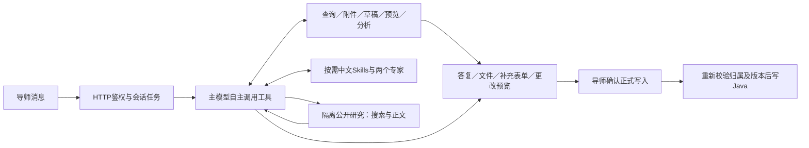

# InsightLink 学业导师助手

独立的 Python Agent 服务，复用现有 Java 后端。导师可查询学生与班级、阅读材料及附件、统计分析、生成图表报告、起草评价和准备留言；正式评价与留言由导师核对预览后确认提交。

## 启动

项目只读取根目录 `.env`，其中保存实际配置值。`.env.example` 列出36项应用配置和9项Compose部署配置，并按用途提供中文说明。首次将模板复制为 `.env` 后填写，已有 `.env` 不要覆盖。核对模型、业务和数据库地址后，在项目根目录执行：

```bash
docker compose up -d --build
```

自动构建 Agent、附件和分析镜像，启动 MongoDB 并等待健康后启动服务。需要 Docker Engine 或 Docker Desktop 的 Linux 容器模式，以及 Docker Compose 2.24 以上。Docker 部署通过宿主 socket 创建临时沙箱，无需手工创建 SSH Context。

`.env` 中每一项都可编辑，字段注释集中放在 `.env.example`；通常只需要修改模型、附件域名和以下部署项：

| 配置 | Docker部署时的含义 |
|---|---|
| `AGENT_BIND_ADDRESS` / `AGENT_PORT` | 宿主监听地址与端口。默认 `127.0.0.1:8001`；直接允许其他机器访问时将地址改为 `0.0.0.0`。 |
| `DOCKER_JAVA_BASE_URL` | 容器访问Java的地址。同宿主可用 `http://host.docker.internal:8080`，其他机器填其实际IP/域名；不能用容器自身的localhost。 |
| `DOCKER_MONGODB_URL` | 默认 `mongodb://mongodb:27017` 使用内置MongoDB。沿用旧聊天和记忆时填写容器可访问的原数据库URI。 |
| `MONGODB_DATABASE` / `MONGODB_COLLECTION` | 两种运行方式共用的数据库名称和集合前缀；保留原值才能定位原数据，不会自动迁移数据。 |
| `CORS_ORIGINS` | 浏览器访问前端的来源地址；前端和Agent分机部署时按实际站点修改。 |
| `AGENT_IMAGE` / `MONGODB_IMAGE` | Agent构建标签和内置MongoDB镜像版本。 |
| `ATTACHMENT_SANDBOX_IMAGE` / `ANALYSIS_SANDBOX_IMAGE` | 两个沙箱的镜像标签；Compose构建名称和Agent调用名称保持一致。 |
| `DOCKER_SOCKET_PATH` | Docker宿主上的socket路径；默认 `/var/run/docker.sock`。只交给可信Agent服务，不传入沙箱。 |
| `AGENT_MEMORY_LIMIT` / `MONGODB_MEMORY_LIMIT` | 两个常驻服务的内存上限，默认 `1g` / `768m`。 |

模型、评分、分页、压缩、搜索及观测参数由两种方式共用。`JAVA_BASE_URL`、`MONGODB_URL`、`DOCKER_CONTEXT` 用于本机Python；Compose自动选择上表中的容器地址，并在容器内固定使用 `default` Context。即使配置外部MongoDB，当前Compose仍会启动自带的MongoDB服务。

```bash
docker compose ps -a                 # 检查服务状态
docker compose logs --tail 100 agent # 查看Agent日志
docker compose down                  # 停止；保留MongoDB命名卷
```

修改 `.env` 后执行 `docker compose up -d` 应用新值；修改代码或沙箱后加 `--build`。不要用 `restart` 更新环境变量，也不要在保留数据时给 `down` 添加 `-v`。`attachment-image` 和 `analysis-image` 部署后显示 `Exited (0)` 是正常状态，实际沙箱按任务创建并删除。健康地址为 `http://部署主机:端口/health`。

如果从Windows使用远程Docker Context执行Compose，整个服务栈都会部署到远程引擎；上表的地址、socket和端口都按远程Docker主机理解。前端仍独立运行，需要指向浏览器可访问的Agent地址。

本机开发方式仍然可用：

```powershell
uv sync --frozen
uv run uvicorn insight_link_agent.app.api:app --host 127.0.0.1 --port 8001
```

前端页面为 `/teacher/assistant`，Agent 默认监听8001。MongoDB必需，启动连接失败则停止服务；无SQLite回退。附件解析和代码分析使用Docker，容器不可用时对应工具明确报错。本机运行和Docker部署不要同时占用8001端口。

本机直接运行 Python 时，在 `.env` 设置 `DOCKER_CONTEXT`（未配置时为 `default`；本机 Docker Desktop 可用 `desktop-linux`）。分析、附件及清理命令显式固定到该 Context；远程 SSH Context 需要事先创建且可非交互访问，修改后重启服务。目标引擎需要以下镜像，将示例 Context 名称替换为实际名称：

```bash
docker --context desktop-linux build -t insight-link-attachment-parser:latest ./sandbox
docker --context desktop-linux build -t insight-link-analysis:latest ./sandbox/analysis
```

Compose 部署会自动构建镜像并使用部署主机的 Docker，不需要手动准备 Context 或执行上述构建命令。

## 如何工作



普通问答只有一个主模型工具循环。模型根据对话理解指代、否定、换话题和工具选择；不再先调用任务分类器，也不再用独立复核器把整段答案拦截。两个专家用于复杂分析，简单查询由主助手直接完成。代码负责身份、参数、对象归属、预算、恢复和正式提交边界。

修改评分标准、长期偏好或技能时，工具才按需检查用户对配置变更的授权；检查失败只拒绝该次配置修改。专门的AI评分草稿仍保留评分校验，正式评价仍由导师确认。

## 目录

```text
src/insight_link_agent/
  app/
    api.py                # HTTP工厂与路由注册
    runtime.py            # 启停、Mongo和服务装配
    dependencies.py       # 身份、归属和租约
    routes/               # chat/actions/grading/runs/history/skills/materials
    services/             # 聊天编排与HITL交互
    execution/            # 独立任务、取消、恢复和资源退出
    streaming/            # SSE观察与心跳
    storage/              # Mongo持久化
  agent/
    main_agent.py         # 每轮入口：模型工具循环
    configuration.py      # 配置修改的按需授权
    models.py             # 辅助模型配置
    assembly.py           # 工具、专家、中间件和Backend装配
    runtime.py            # 图检查点、流式执行和交付
    prompts/              # 中文主提示和隔离公开研究提示
    middlewares/          # 会话预算、记忆、压缩、委派和执行回执
    tools/                # 按对象组织的模型工具
    skills/builtin/       # 中文任务流程SKILL.md
    subagents/            # 学情分析专家／评价与沟通专家
    conversation/         # 对话模型、表单、预览和确认领域对象
    memory/ grading/      # 长期记忆与导师评分标准
    evaluation/ research/ execution/ observability/
  integrations/
    mcp/                  # client/server/auth/cancellation，本地stdio
    web/                  # ERP式搜索与正文客户端
    java_client.py        # 现有Java HTTP适配
    attachments.py        # 附件下载与隔离解析
    analysis_sandbox.py   # 分析容器适配
sandbox/                  # 容器镜像和容器内程序
.env                      # 唯一配置文件：应用参数和Docker部署参数
compose.yaml              # Docker一键构建、启动和健康检查
```

## 保留的功能与边界

- 学生与班级查询；全体学生、材料的分页遍历和范围核对；0分与未评分分开统计。
- PDF/Word等附件隔离解析、偏移连续回读和PDF页选择；逐次重新确认材料权限。
- 两位专家按工具白名单分工；主图和专家加载中文Skills、当前导师记忆及上下文压缩。
- 自主评分草稿、补字段表单或聊天补齐、预览修改与取消、独立确认；无直接模型写入工具。
- 会话搜索、分页、改名、软删除；任务停止、资源清理、Mongo检查点恢复及重复提交保护。
- 导师永久评分标准、长期偏好和技能生命周期；更改按需校验用户授权和版本。
- Docker分析代码、图表、表格和文档产物；下载按导师归属鉴权。
- 公开搜索与网页正文独立运行，仅接收本轮公开问题，不接收学生材料、私有对话或凭据。
- LangSmith只接脱敏统计，按用户选择保持关闭。

业务MCP命令：`python -m insight_link_agent.integrations.mcp.server`。Java的`token`仅在请求上下文和本地stdio通道中传递，不进入提示词、检查点、沙箱或追踪。MCP进程共享不意味着共享导师登录态。
